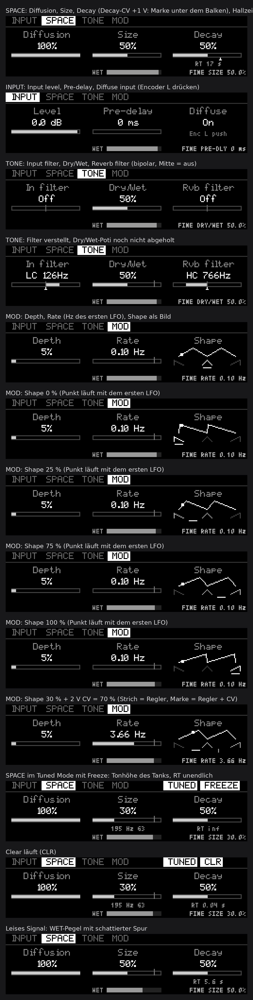

# Sary-Shagan für disting NT

Dattorro-Plate-Reverb als C++-Plug-in für den Expert Sleepers disting NT. In VCV Rack läuft es als **natives Modul** (`vcv/`, 3F4-Panel) oder als DLL in **nt_emu**.

Sary-Shagan ist eine offene Portierung von **Plateau** aus [ValleyRackFree](https://github.com/ValleyAudio/ValleyRackFree) von Dale Johnson (Valley Audio Soft). Der DSP-Kern folgt dem Original Zeile für Zeile. Gegen den Originalcode gemessen liegt die Abweichung ohne Modulation 83–101 dB unter dem Signal, mit Modulation rund 36 dB (Drift der LFO-Phase in float).

**Bedienung und CV-Eingänge folgen Mesa**, dem Hardware-Nachfolger von Plateau (4ms Company + Valley Audio, Handbuch v1.0): ein bipolarer Input Filter und Reverb Filter statt getrennter Low/High-Cuts, Dry/Wet als Überblendung, Input Level, zehn CV-Eingänge mit ±5 V über den ganzen Regelweg, Freeze- und Clear-Gate, Size-CV als Tonhöhen-CV im Tuned Mode. Auf dem NT liegen die Regler auf vier Seiten zu je drei Potis.

Lizenz: GPL-3.0-or-later wie das Original (`LICENSE`). Plateau © 2018–2023 Dale Johnson, Portierung © 2026 xof.

Gebaut gegen distingNT_API v14 (Submodul, Commit 6975a63). 35 Parameter.

**Handbuch:** [`docs/sary-shagan-handbuch.html`](docs/sary-shagan-handbuch.html) (herunterladen und im Browser öffnen). Fertige Dateien zum Installieren liegen in [`release/`](release/).

## Installation

- **NT:** `release/sary_shagan.o` nach `programs/plug-ins/` auf die microSD-Karte, NT neu starten, Algorithmus **Sary-Shagan** hinzufügen.
- **VCV Rack, natives Modul:** `release/3F4-SaryShagan-2.1.0-win-x64.zip` nach `%LOCALAPPDATA%\Rack2\plugins-win-x64\` entpacken (Ordner `3F4-SaryShagan`), Rack neu starten, **3F4 → Sary-Shagan**. Details und Panel: [`vcv/README.md`](vcv/README.md).
- **VCV Rack über nt_emu (Windows):** `release/sary_shagan.dll` nach `%LOCALAPPDATA%\Rack2\disting-nt-plugins\`, in nt_emu laden.

## Bauen

```
git clone --recurse-submodules https://github.com/xof-112/sary-shagan.git
cd sary-shagan
make            # plugins/sary_shagan.o   (arm-none-eabi-gcc)
make test       # Simulation ohne Hardware, 65 Prüfungen (g++)
make win        # emu/sary_shagan.dll     (x86_64-w64-mingw32-g++)
make compare    # Vergleich mit dem Original-Plateau (Submodul third_party/ValleyRackFree)
make render     # render/sary-shagan-screens.png
make handbuch   # docs/sary-shagan-handbuch.html (Python 3 + Pillow; vorher make -C vcv/test)
make release RACK_DIR=…   # release/: .o, .dll, VCV-ZIP
```

Bereits geklont ohne Submodule: `git submodule update --init`. Das VCV-Modul: [`vcv/README.md`](vcv/README.md). Ein Rack-SDK wird neben dem Repo unter `../Rack-SDK` erwartet (oder `RACK_DIR=…`); unter Linux baut `vcv/tools/rack-sdk-from-source.sh` eines aus dem Rack-Quelltext.

## Aufbau

| Pfad | Inhalt |
|---|---|
| `sary_shagan.cpp` | das NT-Plug-in: Parameter, Bedienung, Display (`SARY_SHAGAN_VERSION`) |
| `sary_shagan_dsp.h` | der Dattorro-Tank, Portierung von Plateau |
| `test/host.cpp` | Simulation, `--render` (Bildschirme), `--list` (Parameterliste) |
| `test/compare.cpp` | Vergleich mit `third_party/ValleyRackFree` |
| `emu/` | Windows-Brücke für nt_emu, `testhost.cpp` (Ladetest unter Wine) |
| `render/` | Bildschirm-Bogen, `parameter.tsv` |
| `vcv/` | natives VCV-Modul 3F4-SaryShagan (NT-Host, Panel-Kit, Tests) |
| `docs/handbuch/` | Quellen des Handbuchs, `build.py` |
| `release/` | fertige Dateien der aktuellen Version |
| `CLAUDE.md` | Arbeitsnotizen: Konventionen, Versionen, offene Punkte |

## Bedienung am NT

Vier Seiten wie die Reglergruppen an Mesa. Sary-Shagan startet auf SPACE.

| Element | INPUT | SPACE | TONE | MOD |
|---|---|---|---|---|
| Pot L | Input level | Diffusion | Input filter | Mod depth |
| Pot C | Pre-delay | Size | Dry/Wet | Mod rate |
| Pot R | – | Decay | Reverb filter | Mod shape |

| Element | Funktion |
|---|---|
| Encoder L drehen | Seite INPUT ↔ SPACE ↔ TONE ↔ MOD |
| Encoder L drücken | Diffuse input an/aus (Mesa: Taste *Diffuse Input*) |
| Encoder R drehen | Feinabstimmung des zuletzt bewegten Potis (0,2 % je Raste, Pre-delay 1 ms, Level 0,1 dB); nach einem Seitenwechsel der mittlere Poti |
| Encoder R drücken | Tuned an/aus (Mesa: *Tuned Size*) |
| Taste 3 | Freeze: hält, solange gedrückt. Mit *Freeze mode* = Latch schaltet sie um. |
| Taste 4 | Clear |

In **nt_emu** kommen Encoder-Klicks unzuverlässig an und Tasten nur beim Loslassen. Dort gilt: **Taste 1 kurz** = nächste Seite, **Taste 2** = Tuned, **Taste 3** schaltet Freeze immer um. Diffuse input über das Parametermenü. Taste 1 lang öffnet wie gewohnt das Menü.

**Abholen der Potis:** Nach einem Seitenwechsel ändert ein Poti erst etwas, wenn es den aktuellen Wert überstreicht. Bis dahin zeigt ein senkrechter Strich im Balken, wo das Poti steht.

**Display:** Kopfzeile mit den Seiten und CLIP (Eingang über 9,6 V), TUNED, FREEZE bzw. CLR. Darunter je Poti Name, Wert und Balken. Die Filter-Balken laufen von der Mitte aus (Mitte = aus). Eine kleine Marke unter dem Balken zeigt, wo Regler + CV tatsächlich stehen. Auf SPACE steht unter Decay die geschätzte Hallzeit (RT60), im Tuned Mode unter Size die Tonhöhe des Tanks. Auf MOD zeigt die Spalte Shape statt Zahl und Balken die aktuelle LFO-Form als Bild (zwei Perioden, ein Punkt läuft mit dem ersten LFO), darunter die drei Grundformen Ramp down, Triangle, Ramp up. Die nächstliegende leuchtet am hellsten, ein Strich darunter wandert mit dem Regler von links nach rechts, eine kleine Marke zeigt Regler + CV. Fußzeile, verortet wie die Bedienelemente: in der Mitte unter dem mittleren Poti der WET-Pegel (Hallanteil am Ausgang, −48 dB bis 10 V, schattierte Spur, über 9 V heller), rechts über Encoder R in Großbuchstaben, was FINE gerade einstellt (z. B. „FINE RATE 0.10 Hz“).



## CV-Eingänge (wie Mesa)

Jeder CV-Eingang wird auf der Menüseite *CV inputs* einem NT-Eingang oder Bus zugewiesen (ab Werk „None“). Wie bei Mesa gilt ±5 V = ganzer Regelweg, addiert zur Reglerstellung: Regler auf 0 % und +5 V ist wie Regler auf 100 %. Der Wert des Parameters selbst bleibt dabei stehen.

| Eingang | wirkt auf | Besonderheit |
|---|---|---|
| In filter CV | Input filter | |
| Diffusion CV | Diffusion | |
| Size CV | Size | **Im Tuned Mode** Tonhöhen-CV: 1 V/Okt, +1 V = eine Oktave höher (Mesa: Polarität umgedreht, exponentiell) |
| Dry/Wet CV | Dry/Wet | |
| Rvb filter CV | Reverb filter | |
| Pre-delay CV | Pre-delay | |
| Mod depth CV, Mod rate CV, Mod shape CV | Modulation | |
| Decay CV | Decay | bei Freeze ohne Wirkung |
| Freeze gate | Freeze | Schwelle 2 V. Momentary: friert ein, solange das Gate anliegt. Latch: jede steigende Flanke schaltet um. |
| Clear gate | Clear | steigende Flanke über 2 V |

Der NT hat zwölf Eingänge. Mit zwei Audio-Eingängen bleiben zehn für CV und Gates. Was nicht auf eine Buchse passt, kann von einem anderen Algorithmus über einen Aux-Bus kommen.

## Parameter

| Seite | Parameter | Bereich | Standard |
|---|---|---|---|
| Input | Input level | −inf … +2,5 dB (Mesa: bis 1,3-fach) | 0 dB |
| | Pre-delay | 0–500 ms | 0 ms |
| | Diffuse input | Off · On | On |
| Space | Diffusion | 0–100 % | 100 % |
| | Size | 0–100 % (Zeitskala 0,01–4, Tuned: 5 Oktaven) | 50 % |
| | Decay | 0–100 % (Plateau-Kurve 0,1–0,9999) | 50 % |
| Tone | Input filter | −100 … +100 %: Mitte aus, nach oben Low cut bis 3,5 kHz, nach unten High cut bis 110 Hz | aus |
| | Dry/Wet | 0 % nur trocken, 50 % gleich laut, 100 % nur Hall (Equal-Power-Überblendung) | 50 % |
| | Reverb filter | wie Input filter, im Tank | aus |
| Modulation | Mod depth | 0–100 % | 5 % (Mesa-Empfehlung) |
| | Mod rate | 0,10–10 Hz (erster der vier LFOs) | 0,10 Hz |
| | Mod shape | Ramp down … Triangle … Ramp up | Triangle |
| Modes | Freeze | Off · On | Off |
| | Freeze mode | Momentary · Latch (Taste 3 und Gate) | Momentary |
| | Clear | Off · On (steigende Flanke) | Off |
| | Tuned | Off · On | Off |
| | Saturation | Off · On: weich ab 7,5 V bis 10 V (Mesa: ab 75 %) | On |
| CV inputs | 10 CV-Eingänge, Freeze gate, Clear gate | Bus | – |
| Routing | Input L / Input R | Bus | In 1 / In 2 (R = None nimmt L) |
| | Output L / R mit Mode | Bus, Add · Replace | Out 1 / Out 2, Add |

Unter 100 % Dry/Wet die Ausgänge auf *Replace* oder eigene Busse legen, sonst kommt das trockene Signal doppelt.

## Unterschiede zu Plateau und Mesa

- **Sample-Rate im Tank:** Plateau rechnet den Tank intern immer mit 44,1 kHz (Begrenzung im Code, Tank-Filter ohne Sample-Rate). Bei 48 kHz klingt Plateau dadurch einen ~9 % kleineren, helleren Raum. Sary-Shagan skaliert korrekt und klingt bei jeder Rate wie Plateau bei 44,1 kHz. Die LFOs folgen ebenfalls der echten Rate.
- **Von Mesa übernommen:** Bedienung, Filter-Regler, Dry/Wet, Input Level, CV-Eingänge, Freeze momentan/Latch, Size-CV im Tuned Mode, weiche Ausgangsbegrenzung.
- **Nicht übernommen:** Mesas **Reverse** (rückwärts in den Tank) ist neue DSP und fehlt. Mesa rechnet mit 96 kHz und double, Sary-Shagan mit der NT-Rate und float. Keine Clip-LEDs, stattdessen CLIP im Display.
- CVs und Gates werden blockweise gelesen, Size, Decay, Dry/Wet, Pre-delay, Mod depth und Input level sind geglättet.
- Clear löscht den Speicher in Portionen über mehrere Audioblöcke.

## Ressourcen

Delay-Speicher im DRAM: ~790 KB bei 48 kHz, ~1,6 MB bei 96 kHz. Eingangs-Allpässe (~6 KB) im DTC. Aus libm nur `expf`. Die Überblendung nutzt eine Sinus-Näherung, die Anzeige eine eigene log2-Näherung.

## Stand der Prüfung

- `make test`: 65 Prüfungen – Impulsantwort, Dry/Wet (0 % exakt trocken), Input level −inf, Stabilität über 60 s bei maximalem Decay, Freeze per Gate (momentan und Latch), Clear, Tuned mit Size-CV 1 V/Okt, CV-Summierung und Begrenzung, bipolare Filter, 200 Parameteränderungen im Lauf, Bedienung (Seiten, Abholen, Feinabstimmung, Tasten, Encoder-Druck) und alle Bildschirme in den Grenzen des Displays (nt_emu-Schriften).
- `make compare`: Vergleich mit dem Original-Plateau-Code (siehe oben).
- `emu/testhost.cpp` unter Wine: DLL lädt über die Brücke, Hall, Bedienung und Zeichnen laufen (zuletzt 24.10.2026).
- `make -C vcv/test`: 25 Prüfungen des NT-Hosts mit dem echten Plug-in.

**Noch nicht auf echter Hardware und nicht in echtem VCV Rack gelaufen.** Die CPU-Last am NT ist nicht gemessen.

## Dank

Dale Johnson für Plateau und dafür, es offen zu veröffentlichen. 4ms Company und Valley Audio für Mesa, dessen Bedienung hier Vorbild ist. Jon Dattorro für den Algorithmus (J. Audio Eng. Soc. 45(9), 1997).
