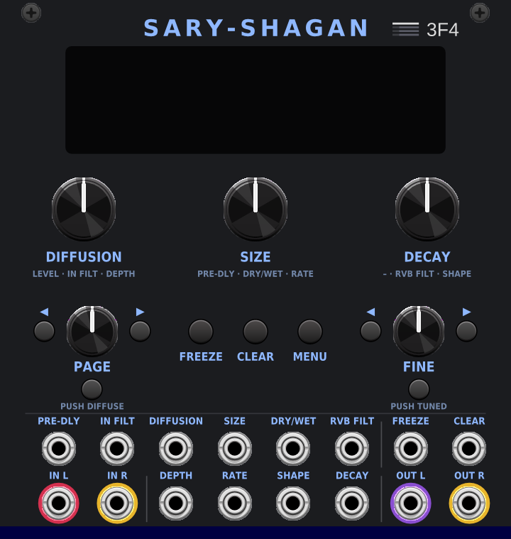

# Sary-Shagan für VCV Rack 2

Von **3F4** (3rdFloor4).

Sary-Shagan als natives Rack-Modul (24 HP): ein Dattorro-Plate-Reverb, Portierung von **Plateau** aus [ValleyRackFree](https://github.com/ValleyAudio/ValleyRackFree) von Dale Johnson (Valley Audio Soft). Bedienung und Buchsen folgen **Mesa** (4ms Company + Valley Audio). Im Modul läuft **derselbe Code wie auf dem disting NT** (`../sary_shagan.cpp`, unverändert), getragen vom NT-Host aus Perseids (`src/nt_host.*`). Klang, Bedienung und Display sind damit wie am NT, das Display zeigt das NT-Display Pixel für Pixel.

Lizenz GPL-3.0-or-later wie Plateau. Plateau © 2018–2023 Dale Johnson, Portierung © 2026 xof.

## Installieren

Mit dem fertigen Paket: `release/3F4-SaryShagan-2.1.0-win-x64.zip` nach `%LOCALAPPDATA%\Rack2\plugins-win-x64\` entpacken, sodass dort der Ordner `3F4-SaryShagan` liegt (mit `plugin.dll` und `plugin.json` direkt darin), und Rack neu starten. Das Modul steht dann unter **3F4 → Sary-Shagan**. Eine ältere Fassung (Ordner oder .vcvplugin) vorher entfernen.

Selbst bauen (MSYS2 MinGW 64 oder Linux/macOS, Rack SDK 2.x):

```
cd vcv
make RACK_DIR=<Pfad zum Rack-SDK> install     # Standard: ../../Rack-SDK, also neben dem Repo
make RACK_DIR=<Pfad zum Rack-SDK> dist        # dist/3F4-SaryShagan, ausgeliefert als ZIP dieses Ordners
```

Der Plug-in-Quelltext und die NT-API kommen aus dem Repo-Wurzelordner (`sources.mk`), also vorher `git submodule update --init`.

Cross-Build für Windows unter Linux (ohne offizielles SDK): `tools/rack-sdk-from-source.sh ../../Rack-SDK`, danach die Schritte im Kopf dieses Skripts (MinGW, `tools/mklibrack.py` für die libRack-Import-Lib). `make dist` endet dort mit einem zstd-Fehler; der Ordner `dist/3F4-SaryShagan` ist trotzdem vollständig.

`make -C test` prüft den Host nativ ohne Rack: Audio, Bedienung, Buchsen, Menü, zwei Instanzen, Speichern.



## Bedienung

Vier Seiten, PAGE blättert. Die drei Potis steuern je Seite drei Parameter, wie die Reglergruppen an Mesa. Die Hauptbeschriftung am Panel gilt für SPACE (Startseite), die kleine Zeile darunter für INPUT · TONE · MOD.

| Panel | INPUT | SPACE | TONE | MOD |
|---|---|---|---|---|
| Poti L | Input level | **Diffusion** | Input filter | Mod depth |
| Poti C | Pre-delay | **Size** | Dry/Wet | Mod rate |
| Poti R | – | **Decay** | Reverb filter | Mod shape |

| Panel | NT | Funktion | im Menü |
|---|---|---|---|
| PAGE (Encoder L) | Encoder L | Seite wechseln | Parameter |
| PUSH DIFFUSE | Encoder-L-Druck | Diffuse input an/aus | nächste Seite |
| FINE (Encoder R) | Encoder R | Feinabstimmung des zuletzt bewegten Potis | Wert ±1 (PUSH gehalten: ±10) |
| PUSH TUNED | Encoder-R-Druck | Tuned an/aus | bestätigen |
| ◀ / ▶ an den Encodern | – | ein Schritt je Druck, gehalten mit Wiederholung | dasselbe |
| FREEZE (leuchtet) | Taste 3 | hält, solange gedrückt (Latch: schaltet um) | – |
| CLEAR | Taste 4 | Hall löschen | – |
| MENU | (Menü des NT) | alle Parameterseiten | schließen |

**Abholen der Potis:** Nach einem Seitenwechsel ändert ein Poti erst etwas, wenn es den aktuellen Wert überstreicht. Bis dahin zeigt ein senkrechter Strich im Balken, wo das Poti steht.

**Rechtsklick-Menü:** Tuned mode, Diffuse input, Freeze latcht (Taster und Buchse), Output soft clip.

**MIDI-Map:** Alle Bedienelemente sind normale Rack-Parameter. Potis auf absolute Regler legen. Ein absoluter CC über den ganzen Weg ergibt beim Encoder 24 Rasten. Pads auf ◀ / ▶, PUSH, FREEZE, CLEAR, MENU.

## Buchsen

IN L/R unten links und OUT L/R unten rechts, wie bei den anderen 3F4-Modulen. Die CV-Eingänge behalten Mesas Spalten (Mod Depth unter Diffusion … Decay unter Rvb Filt), die Gates sitzen oben rechts.

| Reihe | Buchsen |
|---|---|
| oben | PRE-DLY · IN FILT · DIFFUSION · SIZE · DRY/WET · RVB FILT · FREEZE · CLEAR |
| unten | IN L · IN R · DEPTH · RATE · SHAPE · DECAY · OUT L · OUT R |

- **CV-Eingänge:** ±5 V = ganzer Regelweg, zur Reglerstellung addiert. Das Display zeigt mit einer Marke unter dem Balken, wo Regler + CV stehen.
- **SIZE im Tuned Mode:** Tonhöhen-CV, 1 V/Okt, +1 V = eine Oktave höher.
- **FREEZE:** Gate über 2 V friert ein, solange es anliegt. Mit „Freeze latcht“ schaltet jede Flanke um.
- **CLEAR:** steigende Flanke über 2 V löscht den Hall.
- **IN R** leer: IN L auf beiden Seiten.

Intern liegen die zehn CVs auf den NT-Eingängen 3–12, FREEZE und CLEAR auf den Aux-Bussen 21/22 (der NT hat nur zwölf Eingänge). Im Menü heißen sie wie die Buchsen („Size jack“, „Freeze jack“ …) und lassen sich auf der Seite *CV inputs* umlegen. Am NT stehen sie ab Werk auf „None“.

## Speichern

Alle Parameter werden mit dem Patch gespeichert, nach Namen (wie im NT-Preset). Der Inhalt des Halls nicht. **Initialize** setzt alles auf Werkseinstellung, die Buchsen bleiben verdrahtet.

## Aufbau

- `src/SaryShagan.cpp`: das Rack-Modul, Panel-Widget, Endlos-Encoder und Display.
- `src/nt_host.*`, `src/nt_api.cpp`, `src/nt_globals.cpp`, `src/nt_raster.h`, `src/fonts/`: der NT-Host aus Perseids (`nt/vcv/src`, `nt/render/nt_raster.h`). Einzige Erweiterung: `Host::Frame` nimmt zusätzlich bis zu vier Eingänge für die Aux-Busse 21–24. Schriften aus nt_emu (MIT, © Neal Sanche; Selawik OFL, pixelmix freeware).
- `panel_def.py` erzeugt `res/SaryShagan.svg` und `src/panel_layout.hpp`. Positionen nur dort ändern. Stil aus dem 3F4-Panel-Kit `style/` (aus Perseids). Abweichend vom Kit stehen die drei Taster im Raster 13 statt 11, damit FREEZE und CLEAR nicht zusammenstoßen.
- `tools/mklibrack.py`: Import-Bibliothek für libRack.dll für den Windows-Cross-Build unter Linux. `tools/pack.py`: .vcvplugin ohne zstd-Programm (für die Library; ausgeliefert wird als ZIP des Ordners `dist/3F4-SaryShagan`).
- `test/`: `host_test.cpp` (25 Prüfungen), `host-screens.png`, `panel-preview.png` (Rack-eigener SVG-Renderer, `make panel`).

## Stand

Unter Linux gebaut und nativ getestet, Windows-DLL per Cross-Build (MinGW, Rack 2.6.4-Header). **In echtem VCV Rack noch nicht gelaufen.**
